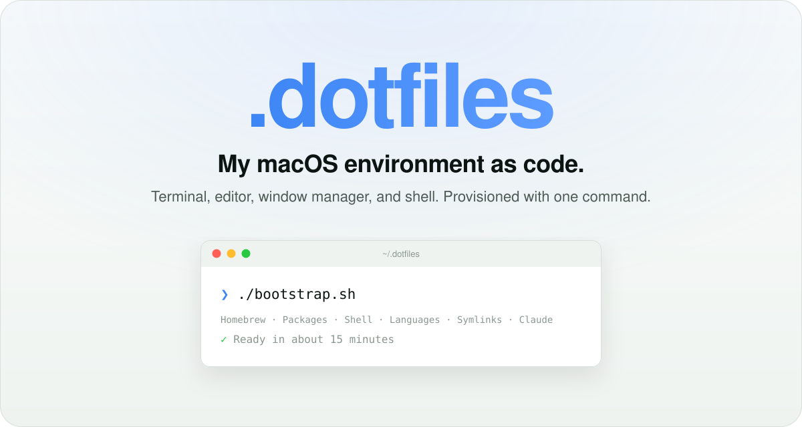
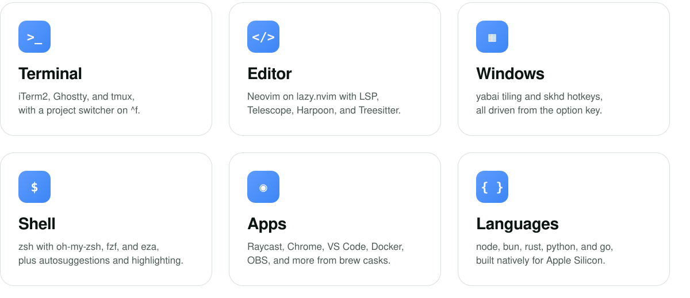
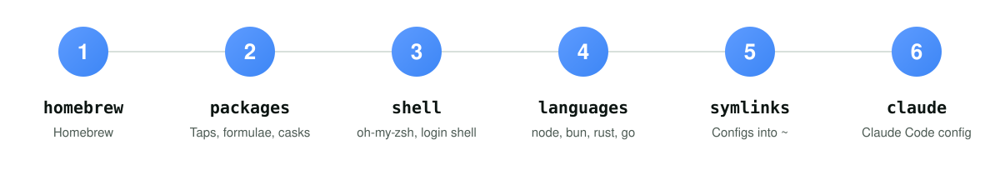

<div align="center">

<picture>
  <source media="(prefers-color-scheme: dark)" srcset="docs/assets/hero-dark.svg">
  
</picture>

<br>
<br>

[](https://www.apple.com/macos/)
[](https://www.ansible.com/)
[](https://neovim.io/)
[](https://www.zsh.org/)
[](https://github.com/alexcloudstar/.dotfiles/releases)
[](https://github.com/alexcloudstar/.dotfiles/commits/main)
[](#license)

<br>

[Quick start](#quick-start) &nbsp;·&nbsp;
[What's inside](#whats-inside) &nbsp;·&nbsp;
[Provisioning](#provisioning) &nbsp;·&nbsp;
[Installed software](#installed-software) &nbsp;·&nbsp;
[Structure](#folder-structure) &nbsp;·&nbsp;
[Customize](#customize)

</div>

<br>
<br>

<picture>
  <source media="(prefers-color-scheme: dark)" srcset="docs/assets/features-dark.svg">
  
</picture>

## Quick start

This is my personal setup. Fork it, change the package lists and git identity, then run it.

```zsh
git clone https://github.com/alexcloudstar/.dotfiles ~/.dotfiles
cd ~/.dotfiles
./bootstrap.sh
```

`bootstrap.sh` asks for your sudo password once. The first run takes about 15 minutes. Without access to my private Claude Code config (see below), the `claude` role skips itself.

> [!WARNING]
> **Read before you run it.** The playbook changes your machine:
> - Replaces `~/.zshrc`, `~/.gitconfig`, `~/.tmux.conf`, and the other linked configs with symlinks. Existing files are overwritten with no backup. `gitconfig/.gitconfig` contains my name and email, so change it first.
> - Sets Homebrew zsh as your login shell.
> - Installs 33 formulae and 14 casks from [`packages/vars/main.yml`](ansible/roles/packages/vars/main.yml).
>
> To preview without changing anything: `cd ansible && ansible-playbook site.yml --check --diff --ask-become-pass`.

> [!NOTE]
> **Apple Silicon only.** Homebrew lives at `/opt/homebrew`, and `bootstrap.sh` exits if it detects Rosetta. Intel Macs need manual path changes in `zsh/.zshrc`.

<details>
<summary><strong>The <code>claude/</code> folder is a private submodule</strong></summary>

<br>

`claude/` holds my Claude Code config (`git@github.com:alexcloudstar/dotfiles-claude.git`) and is not public.

- **A plain clone** leaves `claude/` empty. The `claude` role checks for `claude/CLAUDE.md` and ends itself with a message when it is missing, so nothing in `~/.claude` is touched.
- **`git clone --recurse-submodules`** fails without access to that repo.
- **Forking:** point `.gitmodules` at your own repo, or skip the role explicitly with `--skip-tags claude`.
- **With access**, clone with submodules:

```zsh
git clone --recurse-submodules https://github.com/alexcloudstar/.dotfiles ~/.dotfiles
cd ~/.dotfiles && ./bootstrap.sh
```

</details>

## What's inside

| Tool | What it is | Lives in | Linked to |
| :--- | :--- | :--- | :--- |
| [**Neovim**](https://neovim.io) | Lua config, plugins via lazy.nvim | `nvim/` | `~/.config/nvim` |
| [**Zsh**](https://www.zsh.org) | oh-my-zsh, fzf, eza | `zsh/` | `~/.zshrc`, `~/.fzf.zsh` |
| [**tmux**](https://github.com/tmux/tmux) | Terminal multiplexer | `tmux/` | `~/.tmux.conf` |
| [**yabai**](https://github.com/asmvik/yabai) | Tiling window manager | `yabai/` | `~/.config/yabai` |
| [**skhd**](https://github.com/asmvik/skhd) | Hotkey daemon for yabai | `skhd/` | `~/.config/skhd` |
| **Git** | Aliases: `co` `br` `ci` `st` `lg` | `gitconfig/` | `~/.gitconfig` |
| **Local scripts** | `tmux-sessionizer` (`^f` in zsh), `cht.sh` (`prefix + i` in tmux) | `local/` | `~/.local/bin` |
| **Claude Code** | Private submodule: `CLAUDE.md`, settings, guides, mods, skills, hooks | `claude/` | `~/.claude`, `~/.agents/skills` |

## Provisioning

`bootstrap.sh` installs Xcode CLT, Homebrew, and Ansible, then runs `ansible/site.yml`. Six roles run in this order. Every role is idempotent, so re-run any time to reconverge.

<picture>
  <source media="(prefers-color-scheme: dark)" srcset="docs/assets/flow-dark.svg">
  
</picture>

<details>
<summary><strong>Role details</strong></summary>

<br>

| # | Role | What it does |
| :-: | :--- | :--- |
| 1 | `homebrew` | Installs Homebrew if missing, then updates it |
| 2 | `packages` | Installs taps, formulae, and casks from `ansible/roles/packages/vars/main.yml` |
| 3 | `shell` | Installs oh-my-zsh, `zsh-autosuggestions`, and `zsh-syntax-highlighting`. Sets Homebrew zsh as the login shell |
| 4 | `languages` | Installs nvm + node LTS, bun, rustup (native aarch64), global npm packages, and go tools |
| 5 | `symlinks` | Links configs into `~/.config`, `~/.local/bin`, and `~` directly (no `stow`) |
| 6 | `claude` | Links `claude/` into `~/.claude` and `~/.agents/skills` |

- **`packages`**
  - Creates `/usr/local/cli-plugins` (needs sudo) so the Docker Desktop cask can link its plugins.
  - Leaves apps already in `/Applications` alone. To hand one to brew, trash it and run `brew install --cask <name>`.
  - The `upkeep` tag (`brew upgrade` + `brew cleanup`) never runs by default.
  - Python comes from the `python@3.14` formula. `.zshrc` puts its unversioned `python` and `pip` first on `PATH` and aliases `python` to `python3`. There is no pyenv, uv, or pipx.
- **`shell`** adds Homebrew zsh to `/etc/shells` and switches your login shell (needs sudo).
- **`claude`** links `CLAUDE.md`, `settings.json`, `guides`, `mods`, and `skills` into `~/.claude`, `skills` into `~/.agents/skills`, and each `hooks/*.sh` into `~/.claude/hooks`. A real directory already at a link destination is moved to `<name>.pre-dotfiles-bak` first.

</details>

### Run a subset

`bootstrap.sh` passes `--ask-become-pass` and forwards its arguments to `ansible-playbook`. When you call `ansible-playbook` by hand, add the flag yourself and use a real terminal: the `packages` and `shell` roles need sudo.

```zsh
cd ansible
ansible-playbook site.yml --tags packages --ask-become-pass
ansible-playbook site.yml --tags symlinks
ansible-playbook site.yml --tags upkeep
```

Every role is a tag, so you can skip one too:

```zsh
./bootstrap.sh --skip-tags claude              # no access to the private submodule
./bootstrap.sh --skip-tags packages            # keep your own brew setup
./bootstrap.sh --skip-tags claude,packages
```

> [!WARNING]
> Skipping `packages` has side effects. The `shell` role expects Homebrew zsh and the `languages` role expects `go` from brew. Install those yourself or skip those roles too.

## Installed software

Everything below is installed by the playbook. Package lists live in [`ansible/roles/packages/vars/main.yml`](ansible/roles/packages/vars/main.yml) and language settings in [`ansible/roles/languages/vars/main.yml`](ansible/roles/languages/vars/main.yml). Edit those files and re-run the matching tag instead of installing by hand.

### Languages and runtimes

| Language | Version | Installed by | Notes |
| :--- | :--- | :--- | :--- |
| **Node.js** | latest LTS (`lts/*`) | [nvm](https://github.com/nvm-sh/nvm) `v0.40.8` | Lives in `~/.nvm`. Global npm packages: `vercel` |
| **Bun** | latest at install time | the official `bun.sh` installer | Lives in `~/.bun` |
| **Rust** | `stable`, `aarch64-apple-darwin` | [rustup](https://rustup.rs) | An x86_64 rustup or toolchain is replaced with a native one |
| **Go** | current Homebrew release | `brew install go` | Tools below are added with `go install` |
| **Python** | `3.14` | `brew install python@3.14` | `python` and `pip` come first on `PATH`, `python` is aliased to `python3`. No pyenv, uv, or pipx |
| **C / C++** | current Homebrew releases | `llvm`, `cmake` | `llvm/bin` is on `PATH` |
| **Lua** | bundled with Neovim | `neovim` | Used for the editor config |

**Go tools:** `gopls`, `gotests`, `gomodifytags`, `go-outline`, `goplay`

### Shell

- **Framework:** [oh-my-zsh](https://ohmyz.sh) with the `robbyrussell` theme.
- **oh-my-zsh plugins:** `git`, `zsh-autosuggestions`, `zsh-syntax-highlighting`, `web-search`. The role clones the two `zsh-` plugins itself.
- **Aliases:** `ls` → `eza --icons=always`, `vim` → `nvim`, `python` → `python3`.
- **Keys:** `^f` opens `tmux-sessionizer`, and the up and down arrows search history by prefix.
- **Login shell:** Homebrew zsh at `/opt/homebrew/bin/zsh`.

### Neovim plugins

Managed by [lazy.nvim](https://github.com/folke/lazy.nvim), pinned in `nvim/lazy-lock.json`.

| Area | Plugins |
| :--- | :--- |
| LSP | `nvim-lspconfig`, `mason.nvim`, `mason-lspconfig.nvim`, `fidget.nvim` |
| Completion | `nvim-cmp` with `cmp-nvim-lsp`, `cmp-buffer`, `cmp-path`, `cmp-cmdline`, `cmp_luasnip`, and `LuaSnip` |
| Syntax | `nvim-treesitter` |
| Navigation | `telescope.nvim`, `harpoon`, `plenary.nvim` |
| Git and history | `vim-fugitive`, `undotree` |
| Editing | `copilot.vim`, `cloak.nvim` (hides secrets in files like `.env`) |
| UI | `lualine.nvim`, `nvim-web-devicons`, `catppuccin`, `tokyonight` |

### Homebrew taps

| Tap | Provides |
| :--- | :--- |
| `asmvik/formulae` | `yabai`, `skhd` |
| `anomalyco/tap` | `opencode` |
| `stripe/stripe-cli` | `stripe` |
| `jithin-sabu/tap` | `purge` |

Brew ignores formulae from third-party taps until they are trusted, so the role runs `brew trust` for `skhd` and `yabai`.

### Formulae

Command-line tools and libraries.

| Group | Package | What it is |
| :--- | :--- | :--- |
| **Shell and terminal** | `zsh` | Current zsh, used as the login shell |
| | `bash` | Bash 5 (macOS ships 3.2) |
| | `tmux` | Terminal multiplexer |
| | `fzf` | Fuzzy finder |
| | `eza` | Modern `ls`, aliased to `ls` |
| | `fd` | Faster `find` |
| | `ripgrep` | Faster `grep` |
| | `tree` | Directory tree view |
| | `wget` | File downloader |
| | `stow` | Symlink manager, installed but not used by the playbook |
| **Editors** | `neovim` | Main editor |
| | `vim` | Fallback editor |
| | `tree-sitter-cli` | Builds Treesitter grammars for Neovim |
| **Window management** | `yabai` | Tiling window manager |
| | `skhd` | Hotkey daemon |
| **Languages and build** | `go` | Go toolchain |
| | `python@3.14` | Python 3.14 |
| | `llvm` | Clang, LLD, and friends |
| | `luarocks` | Lua package manager, used by mason.nvim |
| | `cmake`, `cmake-docs` | Build system and its docs |
| **Dev tools** | `ansible` | Runs this playbook |
| | `gh` | GitHub CLI |
| | `git-filter-repo` | History rewriting |
| | `colima` | Container runtime without Docker Desktop |
| | `railway` | Railway CLI |
| | `stripe` | Stripe CLI |
| | `opencode` | AI coding agent for the terminal |
| | `mcp-publisher` | Publishes MCP servers to the registry |
| | `geckodriver` | WebDriver for Firefox |
| **Media and AI** | `ffmpeg-full` | Video and audio processing |
| | `whisper.cpp` | Local speech-to-text |
| **Other** | `tor` | Tor daemon |

### Casks

macOS apps and fonts.

| Group | Package | What it is |
| :--- | :--- | :--- |
| **Terminals** | `iterm2` | Terminal emulator |
| **Editor** | `visual-studio-code` | GUI editor, `code` is linked into `PATH` |
| **Browser** | `google-chrome` | Browser |
| **AI** | `claude` | Claude desktop app |
| | `chatgpt` | ChatGPT desktop app |
| | `codex` | OpenAI's coding agent for the terminal |
| | `ollama-app` | Local LLMs, links the `ollama` command |
| **Dev** | `docker-desktop` | Docker engine and UI |
| **Utilities** | `raycast` | Launcher |
| | `monitorcontrol` | Brightness and volume for external displays |
| | `keycastr` | On-screen keystroke display |
| | `obs` | Screen recording and streaming |
| | `purge` | Clears caches and junk files by moving them to the Trash (from `jithin-sabu/tap`) |
| **Fonts** | `font-meslo-lg-nerd-font` | Meslo Nerd Font for icons in the terminal |

## Folder structure

```
.dotfiles
├── ansible/
│   ├── roles/           # homebrew, packages, shell, languages, symlinks, claude
│   ├── ansible.cfg
│   ├── inventory
│   ├── requirements.yml
│   └── site.yml         # playbook entry point
├── claude/              # submodule: private Claude Code config
├── gitconfig/           # → ~/.gitconfig
├── local/               # scripts → ~/.local/bin
├── nvim/                # → ~/.config/nvim
├── skhd/                # → ~/.config/skhd
├── tmux/                # → ~/.tmux.conf
├── yabai/               # → ~/.config/yabai
├── zsh/                 # → ~/.zshrc, ~/.fzf.zsh
├── bootstrap.sh         # one-command setup
└── LICENSE
```

## Customize

- **Packages:** add formulae, casks, and taps in `ansible/roles/packages/vars/main.yml`.
- **Scripts:** drop them in `local/` and add them to the script list in the `symlinks` role.
- **Everything else:** swap themes, plugins, and shortcuts in each tool's folder.

## Contributing

Issues and PRs welcome.

## License

[MIT](LICENSE)

<br>

<div align="center">
<sub>Built for Apple Silicon. Provisioned with Ansible.</sub>
</div>
